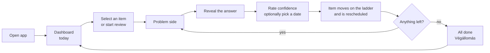
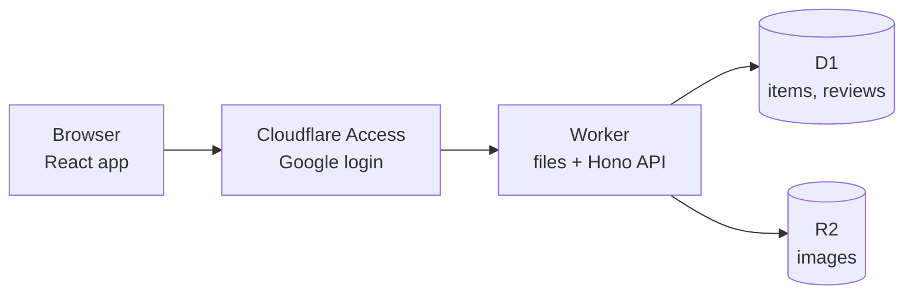

# Mnemos — Design Plan

## Overview

Mnemos is a sleek, fast study scheduler that uses simple spaced repetition on a ladder. You add study items, review the ones due each day, rate how confident you feel, and the item climbs or drops on your ladder of review gaps.

- **Who:** me plus a small group of friends and classmates, each with their own items and settings.
- **Two situations:** a laptop for adding, editing and longer review sessions; a phone for quick reviews, often one-handed on a tram, and for editing when needed.
- **Fast:** no cold starts, no spinners, and screens change instantly.
- **Keyboard-first on desktop, thumb-first on the phone:** every main action has a shortcut on desktop and a big button within thumb reach on the phone.
- **Predictable:** a fixed ladder of review gaps with no complex algorithm. Every confidence button shows the date and stop it leads to.
- **Budapest-themed:** strong where you rest, quiet where you work.
- **Free to run:** everything fits in free plans.

## Core concepts

The app has four things: sections that group items, items you study, reviews that record each study session, and a ladder that turns confidence into days.

- **Section:** a named group of items, such as a subject or problem set, drawn as a metro line. Each section has:
  - a name of up to 60 characters;
  - a short code: 2–3 characters (A–Z, 0–9), unique per person. The app suggests one from the name, but you can always type your own instead, when creating the section or later. The suggestion:
    - strips accents (Gráfok → GRA);
    - for two or more words, takes the initials of the first three (Data structures → DS, Operating systems 2 → OS2);
    - for one word, takes its first three letters (Compilers → COM), with no camelCase splitting (TypeScript → TYP);
    - if that code is taken, swaps the last character for 2–9 (COM → CO2, DS → DS2);
    - gives a one-letter name a digit (C → C2), and gives no suggestion when the name has no usable letters;
  - a line colour, assigned once when the section is created, cycling M2 red → M3 blue → M4 green.

  Reordering or deleting sections never changes a colour. The code, not the colour, identifies a section.

  Deleting a section deletes its items and their reviews too. The confirmation names how many items go, and a plain Enter doesn't confirm it.
- **Item:** one thing to study (fields below). It sits on one stop of the ladder.
- **Review:** one record per time you review an item. It stores the date, your confidence, the stop before and after, the due date the item had, the next due date, and whether you picked that date yourself.
- **Ladder:** up to 7 stops, each with a gap in days (1–365, each longer than the one before). The default is 1, 2, 3, 5, 7, 14 and 28 days. The last stop is the Végállomás ("end of the line").
- **Confidence levels:**
  - **Confident:** the item moves up one stop (on the last stop, it stays there).
  - **Neutral:** the item keeps its stop.
  - **Not at all:** the item goes back to stop 1.

| Item field | Required | Notes |
| --- | --- | --- |
| Name | Yes | Shown in lists and on the dashboard. In review it is hidden until the answer is shown, because it can give the answer away. Exception: if the problem description is empty, the name is the question. Inline formatting only |
| Section | Yes | One section per item |
| Description | No | Short context, shown above the problem. Inline formatting only |
| Problem URL | No | Link to the original problem. Opens in a new tab and never reveals the answer |
| Problem description | No | Text of the problem, in Markdown |
| Problem images | No | Several allowed, in order |
| Answer URL | No | Link to a solution |
| Answer text | No | Your written answer, in Markdown |
| Answer images | No | Several allowed, in order |
| Side note | No | Tips or reminders for next time, in Markdown. Shown last, just above the confidence buttons |
| Stop | Set by the app | Where the item is on the ladder. New items start on stop 1 |

An item's review history comes from its reviews; the item itself doesn't keep a list of dates.

**Text formatting:**

- **Markdown fields:** Problem description, Answer text and Side note use GitHub-style Markdown, including code blocks. As in GitHub comments, a new line is a line break and a blank line starts a new paragraph.
- **Code highlighting:** only a code block that names its language (```` ```python ````) is highlighted; one without a language, such as pseudo-code, stays plain, and so does a language the highlighter doesn't know. Tone-on-tone, with no hue: keywords and built-ins bold, strings and numbers Mist, comments Fog. No italics (the mono face ships upright only).
- **Inline-only fields:** Name and Description allow only inline code, bold and italic.
- **Lengths:** Name up to 300 characters, Description up to 1,000, and each Markdown field up to 20,000.
- **Links:** Problem URL and Answer URL take http and https links only. A link typed without a scheme gets `https://` ("example.edu/x" → "https://example.edu/x").
- **Not allowed:**
  - raw HTML;
  - images inside Markdown (images go in the image fields);
  - math formulas, for now.

## App flow and screens

The app opens on today's dashboard; a new account first goes through a practice day (First-run tutorial, below). Reviewing is a short loop: read the problem, reveal the answer, rate, move on.



Opening one item from the dashboard returns there after rating. On phones, confirmations (deleting an item or a line, discarding changes) are sheets at the bottom with the action above Cancel; on desktop they are dialogs with Cancel focused, so a plain Enter never confirms. Flash review runs the loop over a whole set, and when nothing is left for today, the All done screen appears.

| Screen | Purpose | Shows |
| --- | --- | --- |
| Dashboard | See one day at a glance | **Week strip:** Monday to Sunday of the week the board shows: reviews done on past days ("–" when none), items left today, items due on future days. `[` and `]` move a day (into the next week too), the desktop arrows a week, and on the phone (below 1024 px) a calendar button opens a month in a sheet, beside a Today button when away from today. Below 1024 px the strip also swipes sideways, snapping to whole weeks: like the arrows, settling on the previous or next week moves the board to the same weekday there (added after the phase 4 phone check, issue #13; the mockups don't show it). A week not fetched yet shows its dates first and its counts as they arrive. The day is in the address (`/?day=2026-09-25`, today is plain `/`); moving between days replaces the history entry, so Back leaves the dashboard. **Summary line:** left · late · done. **Sections:** each drawn as a metro line, listing its items with their stop and overdue delay. **Start review** button. **On a future day:** that day's items, with the ones already reviewed today dimmed (Fog title and squares, Edge ring, "Reviewed today"), listed last in their section, not links and skipped by J/K; the yellow Review early button and the line buttons are left out when there is nothing to review early. **On a past day:** only the reviews done that day, in the same line cards: the stop each moved to, the confidence in words, and the "1 day early" and "picked" marks; a row opens its item's history |
| Review mode | Study one item | **Problem side:** description, problem, images and link. **Reveal:** tap or click anywhere, or press Space; images open zoom and links open normally instead. **Answer side:** the name as a heading, then answer text, images, link and side note; the problem shrinks to a card with thumbnails. **Rating:** three confidence buttons, each showing the date and stop it leads to, plus Pick a date (pick the date first; the buttons then show it, and you still rate). **Undo:** available for 4 s after rating, from the pop-up or U; it brings the item back as the current one, answer showing. The pop-up sits at the top on the phone and above the rating buttons on desktop; after the day's last rating it sits at the top right on desktop, clear of All done and its Review early. **Edit:** E, Edit in the header, or ··· on the phone opens the item in the editor; saving or cancelling comes back to the same place in the run, and an item deleted there is skipped |
| Flash review | Review a set in one run | All items due today, or all of one section's. Goes section by section in your section order; within a section, the latest items come first (most days late first), then the ones due today, with equally late items in creation order, oldest first. Starts with "Kérjük, vigyázzanak, az ajtók záródnak!" under two metro doors that slide shut once in 150 ms as the screen opens (still with reduced motion); Start never waits for them. **Review early** runs a future day's items not yet reviewed today the same way (`/flash?day=…`, then `/review?day=…`), and ends back on that day |
| All done | The rest moment when nothing is left today | Végállomás over the Parliament illustration, the week strip, today's count, tomorrow's due count, and a neutral Review early button (F) for tomorrow's items not yet reviewed today, left out when there are none. On the phone the picture comes first, then the date and the strip |
| Items | Find and manage items | **Search:** Name, Description, Problem description and Side note, ignoring case and accents. **Filter** by section. **Sort:** by next due (earliest first, equal dates oldest first) or recently added (newest first). **Status:** each row shows "+3 days", Due today or Reviewed today; above the list, "23 items · 3 late · 5 more due today · 1 reviewed today". A table on desktop, two-line rows on the phone |
| Item editor | Add or edit an item | **Fields:** every item field. **Images:** paste or drop on desktop, camera or photo library on the phone; reorder and remove. **Section picker:** find a section by name or code, or type a new name to create it on the spot: the section is made at once, with the suggested code (or one the person types) and the next colour. **Markdown fields:** a Write / Preview toggle; on touch screens, a Code button wraps the selection in backticks (a fenced block when it spans lines), on the Name and Description too. **Save:** stays within reach: a bar at the top on desktop (Ctrl/⌘+Enter), a button at the bottom on the phone. **Leaving:** Save, Cancel (Esc) and ✕ go back to where the editor was opened from; with unsaved changes, every way out asks "Discard your changes?" first: Cancel, Esc, ✕, Back, a sidebar link, T, I, `,` and N, and the command menu. **New items** start in the line the Items list is filtered to, or else the line of the last item saved in this browser. **Delete** (the ··· menu on the phone) asks first and says how many reviews go with the item |
| Item history | See how an item has gone | A line map (reviews left to right, stops bottom to top, dot size = confidence, marks for picked dates and early reviews), plus the same data as a table. On the phone, the line map shows the latest 10 reviews, on desktop up to 20; scroll back for older ones. The table always lists them all. **One panel everywhere:** a dialog on desktop, a tall sheet on the phone, over the screen it was opened from: H on the dashboard (any day) and Items, History (H) in the editor and in review (··· on the phone). Esc, Back and ✕ close it, and the screen behind stays as it was. In review before the reveal it keeps the Name hidden. Reviews keep the stop numbers they had; removing a stop doesn't rewrite them, and the map grows taller if an older review sits above today's last stop |
| Settings ("Menetrend") | Tune the ladder; manage the lines and the account | The ladder drawn as a metro line (across on desktop, down on the phone): each stop's gap and item count, add / edit / remove stops, and a preview of where each rating leads from the selected stop. A gap saves on Enter or when the field is left, if it fits between its neighbours; Esc puts the saved gap back. Removing a stop asks first, saying how many items move to which stop and what renumbers, with Cancel focused. Below the ladder: the preview and Account side by side on desktop, then Lines. **Lines:** every line in order with its item count; drag a handle (or focus it and use ↑ ↓) to reorder, which sets the order of the dashboard and flash review; Edit opens the name and code (the colour shows but never changes) and Delete line…; New line makes one with the suggested code and the next colour. The sidebar's "Lines" heading links here. **Account:** who is signed in, Replay tutorial, and Sign out |

## First-run tutorial

A new account starts in a practice day: a copy of Mnemos that runs entirely in the browser, with two sample lines, one prefilled new item and one short review run, then the person's own empty dashboard. Nothing in the practice day is saved; the only write to the server is the "tutorial completed" flag (issue #23).

- **Gate:** the app asks `GET /api/me` alongside the first screen's own data. If the flag is null and the address isn't under `/tutorial`, it replaces the address with `/tutorial`. The first screen shows meanwhile, so a new account may see its empty board for an instant.
- **Addresses:** the practice day mirrors the app's paths under `/tutorial` (`/tutorial`, `/tutorial/items/new`, `/tutorial/flash` …), so Back and reloads behave as they do in the app.
- **The practice copy:** the real screens run against an in-memory copy of the API that follows the same rules as the Worker, so Items and Settings work too, with the sample data. Images added in the practice editor stay in the browser. Leaving the practice day drops all of it, so sample lines never show on the real board.
- **Its today and ladder:** today is the browser's date when the tutorial starts, kept even if it runs past midnight. The ladder is always the default (1, 2, 3, 5, 7, 14 and 28 days), whatever the person's own is.

**Sample data:** two lines and three items, plus the one the person saves: a run of 4 items, 1 of them late. The practice lines take the first two colours in order, HU red (M2) and AL blue (M3); nothing is saved, so the person's own first line still starts at M2.

| Line | Name | Description and problem | Answer and side note | Stop | Due |
| --- | --- | --- | --- | --- | --- |
| HU · Hungarian words | villamos | Getting around Budapest. What is the Hungarian word for tram? | Plural: villamosok. Budapest's trams are bright yellow. Side note: villám means lightning: villamos first meant "electric". | 4 | 2 days ago |
| HU · Hungarian words | köszönöm | How do you say "thank you" in Hungarian? | köszönöm. "Köszi" is the casual form. | 2 | Today |
| AL · Algorithms | Binary search on 1,000 items | At most how many steps does binary search take to find a value among 1,000 sorted items? Plus one image | 10, since 2¹⁰ = 1,024: each step halves what's left, so O(log n). A short `python` code block | 3 | Today |
| HU · Hungarian words | Egészségedre! (prefilled in the editor) | What do you say when someone sneezes, or when you raise a glass? | Egészségedre! (to your health). To a group: Egészségetekre! | 1 once saved | Today |

- **Histories:** villamos has three Confident reviews, 12, 10 and 7 days ago (stops 1→2, 2→3, 3→4), which leaves it due 2 days ago, "+2 days". köszönöm has one, 2 days ago (1→2); Binary search two, 5 and 3 days ago (1→2, 2→3).
- **villamos is first in the run,** so its buttons show three clearly different dates: Confident → stop 5 in 7 days, Neutral → stop 4 in 5 days, Not at all → stop 1 tomorrow.
- **The image** is a static file, `public/tutorial/sorted-array.webp`, drawn in the Dusk style (to come, issue #31).
- **The texts of köszönöm and Binary search** are drafts; the mockups show only their names.

**Tour:** about two minutes, 12 steps on desktop and 14 on the phone. Every step dims the app (Dusk at 72 %). There are two kinds of step:

- **Explain:** the target is cut out of the dimmed app (8 px around it, a 2 px Mist edge), and a card with Next holds the focus. Back goes to the previous Explain step on the same screen.
- **Act:** the real control does it. The target is cut out (10 px around it) and ringed in tram yellow, and stays live: taps reach it and the app keeps the focus, so its keys work. A click on the dimmed area does nothing. The card has no buttons but Skip; its subtext is "Your turn!".

Below 1024 px the steps point at the tab bar, from 1024 px at the sidebar. Key hints show as key chips, by the input rule: shown with a mouse or trackpad, hidden on touch, ⌘ on Apple devices. The phone gets two more steps than desktop, because its dashboard has no New item: it goes through Items, and Save returns there.

| # desktop / phone | Screen | Kind | Target: phone / desktop | Copy: title, then subtext | Ends when |
| --- | --- | --- | --- | --- | --- |
| 1 / 1 | Dashboard | Explain | None | Welcome to Mnemos | Next |
| 2 / 2 | Dashboard | Explain | The HU line card | Lines and stations. Each line groups things to remember. Every item is a station; the squares show its progress! | Next |
| 3 / 3 | Dashboard | Act | The Items tab / New item in the sidebar | Add something to remember (N). Your turn! | Phone: Items opens. Desktop: the editor opens |
| – / 4 | Items | Act | New item | Add something to remember. Your turn! | The editor opens |
| 4 / 5 | Editor | Explain | Name | Name the review item! | Next |
| 5 / 6 | Editor | Explain | Section picker | Pick a line, or type a new name to create one! | Next |
| 6 / 7 | Editor | Explain | The problem and answer cards (the editor scrolls to them) | Input the problem and its answer! You can use images here. | Next |
| 7 / 8 | Editor | Act | Save at the bottom / Save in the top bar | Save it (Ctrl Enter). Your turn! | Saved: back on Items (phone) or the dashboard (desktop) |
| – / 9 | Items | Act | The Review tab | Now review today's items. Your turn! | The dashboard opens |
| 8 / 10 | Dashboard | Act | The floating Start review / the yellow Start review at the top | Review everything due today in one run (F). Your turn! | The flash review start opens |
| 9 / 11 | Flash review start | Act | Start | 4 items on 2 lines, 1 of them late. Start when you're ready (Enter). Your turn! | The run starts |
| 10 / 12 | Review: problem side | Act | None: the problem stays lit | Phone: Think of the answer, then tap anywhere to see it. Desktop: Think of the answer, then click anywhere or press Space to see it. Your turn! | The answer shows |
| 11 / 13 | Review: answer side | Act | The rating buttons, ringed | Pick how confident you feel! Your confidence rating moves this item on the ladder and sets its next review date! | A rating is pressed |
| 12 / 14 | All done | Explain, closing | None: the picture and the Végállomás stay lit | Well done. That's the whole loop. Change the ladder in Settings (Menetrend, "Timetable"). Desktop: Replay this tutorial from `?` or the command menu (Ctrl K). Phone: …; you can replay this tutorial there too. | Go to my dashboard, or Enter |

- **Editor:** it opens with Egészségedre! filled in, in HU, as in the table; the person can change any field. Next moves on.
- **Step 10 (phone 12)** is the one exception to the backdrop: a tap anywhere, the card included (Skip aside), shows the answer.
- **Step 11 (phone 13)** ends on a rating; picking a date first, then rating, counts too. The other three items in the run get no cards.
- **Off the path:** the tour pauses while a dialog or sheet is open (Pick a date, zoom, the section picker) and while the person is off the step's screen, and picks up again when they're back. A target off screen is scrolled into view first; a card never covers its target.

**The card:**

- **Look:** `popover` fill with a 1 px Rule edge, `rounded-xl` (18 px), `shadow-overlay`. The head has the step count ("2 of 12") in mono at 12.5 px Mist, a 56 px progress bar (Swell track, Foam fill) and Skip as a ghost button on the right. Title 18/24 bold Foam; subtext 15.5/23 Mist. Steps 1, 4 and 5 are a title only. The welcome card has the outlined M mark in its head, the only card with a mark.
- **Footer:** Explain cards have Back (ghost; only from the second Explain step on a screen) and Next (the primary pill, with Enter on desktop): Next is the screen's one yellow button. Act cards have no footer.
- **Closing card:** "12 of 12" with a full bar, no Skip, and a neutral Go to my dashboard: nothing yellow sits next to the All done picture. Its backdrop is lighter (50 %), and the picture and the Végállomás stay lit.
- **Act ring:** 2 px tram yellow, 4 px out, says "press this"; a fainter halo 8 px out pulses at rest.
- **Arrow:** a 16 px square turned 45°, in the card's fill, with the Rule edge on its two outer sides.
- **Phone (below 1024 px):** the card is the screen width minus 24 px. Explain cards dock at the bottom, below the target, in thumb reach; with a tall target (the problem and answer cards) the card sits under it. Act cards sit next to their target, with the arrow. Step 1 docks at the bottom; on step 10 the problem stays lit above the card.
- **Desktop:** 360 px wide (400–420 px under wide targets), anchored to the target with a 14 px gap and the arrow: to the right of cards, below fields and header buttons, centred under a wide target such as the problem and answer cards, above the rating buttons. The closing card sits under the Végállomás heading.
- **Motion:** the card fades and rises 4 px in 120 ms; the cut-out moves to the next target in 150 ms. The Act halo's pulse is the app's one looping animation. Nothing moves with reduced motion, the pulse included.
- **Keyboard:** on Explain steps the focus moves into the card and stays there; Enter is Next, and Esc is Skip. On Act steps Esc keeps its meaning in the app (close review, cancel the editor), and the focus stays in the app so its keys work. The whole tutorial works with keys only.
- **Screen readers:** Explain cards are modal dialogs, named by their title and described by their subtext. The text of an Act card is a polite status.

**Leaving and coming back:**

- **Practice banner:** on every practice screen, above the screen's own header: a River bar with a hairline below it and a flask icon, never yellow, since it is information, not an action. Phone: "Practice day · nothing here is saved" and Skip. Desktop: "Practice day · sample lines and items. Nothing here is saved, and you can leave any time." and Skip tutorial. It dims with the app on every step.
- **Skip:** on every card but the closing one, in the banner, and Esc on an Explain card. No confirmation, since the tutorial can be replayed, and no "Discard your changes?", since nothing in the practice day is real. It opens the person's own empty dashboard, with a 4 s toast: "Tutorial skipped. Replay it from `?` or the command menu." (on the phone: "… from Settings.").
- **Finish:** Go to my dashboard, or Enter, on the closing card opens the person's own dashboard.
- **After leaving:** Skip and finishing replace the address, and Back into one of the practice day's earlier addresses opens the same place in the app instead, so the practice day only comes back through Replay (issue #28).
- **Replay:** Replay tutorial in the command menu (Other), at the end of the `?` dialog and in Settings' Account card. The phone has no `?` key or command menu, so on the phone it is Settings. It starts a fresh practice day at step 1 without touching the flag.
- **Resume:** a reload, or switching apps on the phone, comes back to the same step with the same data. A new tab or a later visit starts again at step 1, as does a practice day saved by an older version of the app.

**Completion:** `settings.tutorial_completed_at` (Data model) holds when the person finished or skipped it; null means not yet. `GET /api/me` returns it as `tutorialCompletedAt`. `PUT /api/tutorial` with `{ "completed": true }` sets it to now if it's still null; repeating it changes nothing. Finishing and Skip call it only while the flag is null; Replay never does. If the call fails, the person still goes to their board, and the tutorial comes back on their next visit. Accounts made before the tutorial start null too, so everyone sees it once.

**Mockups:** `docs/design/TutorialCardsDraft.pdf` (tutorial, round 2; issue #30). Like the main draft, it stays out of git.

| Page | Shows | Page | Shows |
| --- | --- | --- | --- |
| 1 | Step 1, phone | 10 | Step 6, phone |
| 2 | Step 2, desktop | 11 | Step 7, phone |
| 3 | Step 8, desktop | 12 | Step 5, desktop |
| 4 | Step 2, phone | 13 | Step 12, desktop |
| 5 | Step 3, phone | 14 | Step 10, phone |
| 6 | Step 4, phone | 15 | Step 11, phone |
| 7 | Step 4, desktop | 16 | Step 12, phone |
| 8 | Step 11, desktop | 17 | Step 6, desktop |
| 9 | Step 5, phone | 18 | The card, placement, banner, steps and behaviour |

Step numbers are the mockups' (desktop). Differences from them, on purpose:

- **Page 5:** the round + beside Start review isn't built; the phone's step 3 points at the Items tab, and the phone has the two extra steps above, so it counts to 14.
- **The sidebar and tab bar** say Review, not Today (issue #12).
- **All done** shows the navy outline, not the gold placeholder.
- **Step 9 (Start on the flash review start)** has no page; it follows steps 3, 7 and 8.

## Scheduling rules

Next due date = review date + the gap of the stop the item lands on, unless you pick a date yourself.

- **Ladder moves:** Confident moves up one stop (staying on the last), Neutral stays, Not at all goes back to stop 1.
- **Manual date:** picking a date replaces only the date. You still rate your confidence, the ladder still moves, and the review records that the date was manual. Only dates after today can be picked; the calendar disables today and the past.
- **New items:** start on stop 1 and are due the day they're added.
- **Overdue:** an item whose due date has passed stays on today's dashboard, marked with how many days late it is ("+3 days" = today minus the due date).
- **Order:** sections follow your section order. Within a section, the latest items come first (most days late first), then the ones due today. Items that are equally late, including all items due today and all of a future day's items, go in creation order, oldest first. On a future day, the items already reviewed today come last in their section. The dashboard and flash review use the same order.
- **Late and early reviews:** the next date always counts from the day you actually review. You can review a future day's items early; an early review works like any other and counts toward today's done.
- **Once a day:** an item can be reviewed at most once per day. After that it shows dimmed as "Reviewed today" on future days and can't be reviewed again until tomorrow. Undo covers a wrong rating.
- **Undo:** puts back the stop and due date the item had before the rating, and deletes the review, so the item can be rated again. Only a review made today can be undone.
- **Other days:** a future day shows the items due then. A past day shows only the reviews you did that day; missed items don't appear there.
- **Ladder edits:** apply from each item's next review; due dates already set stay as they are.
  - **Adding a stop:** adds a new last stop. Its gap starts at double the previous last gap, capped at 365 days, and can be edited. No stop can be added once the ladder has 7 stops or its last gap is already 365 days.
  - **Removing a stop:** its items move down one stop (stop 1's items stay on the new stop 1), and the stops after it renumber.
  - **Minimum:** a ladder always keeps at least one stop.
  - **Past reviews:** keep the stop numbers they had when they were made.
  - **Two windows:** each change carries the ladder the person saw; if it has changed since, nothing happens and the app shows the ladder as it is now.

**Counts** have one definition everywhere:

| Count | Definition |
| --- | --- |
| Left | Items due today or earlier that you haven't reviewed today |
| Late | The part of Left that was due before today (never added on top) |
| Done | Reviews made today, early ones included |
| Due | Items scheduled for a future day, including ones already reviewed today |
| Early | A future day's Due minus the items already reviewed today (the Review early count) |
| Line | Left, for one section |

**Note on "today":** today is the user's local calendar date, not the server's. Workers run in UTC, so at 00:30 in Budapest the server still sees yesterday. Store due dates as plain dates (`2026-09-24`), have the browser send its local date with each request, and never let the server work out "today" itself.

## Visual design

Direction B, "Danube at dusk". The design draft ("Mnemos visual directions", round 3) set the look, and this section summarizes it. Where this plan records a later change, the plan wins over the mockups; `docs/build-plan.md` lists each phase's differences from them, once its milestone closes; until then they're in the PR descriptions. The tokens live in `src/styles/tokens.css`: the draft's (`docs/design/mnemos-tokens.css`) plus the ones added since:

- `kbd-primary` and its foreground, for the key hint inside the yellow button;
- `zsolnay-ground`, `zsolnay-tile` and `zsolnay-tile-alt`, for the Settings band;
- the door animations of the flash review start, 150 ms;
- the focus ring's colour at rest, so it never fades in from the text colour.

- **Dark mode only for now:** the tokens use shadcn/ui's semantic names, so a light theme later is one more block of values.
- **Budapest, strong where you rest, quiet where you work:**
  - **Review mode:** almost no theming.
  - **Dashboard and history:** use the metro-line structure.
  - **Rest moments:** go full Budapest. These are All done, the flash review start, the Settings header and the app icon.

  Every Hungarian phrase has its English translation directly under it.
- **One colour, one meaning:**
  - **Tram yellow #F5C400** is the only accent. It means selected, focused or primary action.
    A key hint inside a yellow button uses a darker yellow fill (#D0A806, `kbd-primary`) with Dusk text.
  - **Section lines** use M2 red, M3 blue and M4 green.
  - **No colour** for confidence, overdue, success or errors. They use words, icons, weight and size.
  - **Lamplight gold (#E3A857)** appears only inside illustrations.
  - **The yellow M** (app icon and favicon) is the one use of yellow outside these rules, as on the metro signs: a tram yellow square with a Dusk M (Atkinson Hyperlegible Next at weight 800, drawn as a path). Inside the app, the sidebar's M stays neutral.
- **Shapes:** circles are items and reviews on a section's line; squares are ladder stops.
- **Type:** Atkinson Hyperlegible Next for text; Atkinson Hyperlegible Mono for code, dates, counts and keys. Nothing under 12 px.
- **Motion:** 150 ms at most, no spinners or skeletons, and no motion at all with reduced motion. The one looping animation is the halo of the tutorial's Act steps (First-run tutorial). The command menu and the shortcut list close at once, without the fade, so keys pressed right after belong to the screen; while any other dialog fades out, its fields and buttons no longer take keys. The phone's bottom sheets slide up, slide away and settle back after a drag in 150 ms too, not vaul's own 0.5 s.
- **Phone:** thumb-first. Buttons are at least 48 px tall (confidence buttons 56 px) and sit at the bottom. Key hints are hidden on touch screens.
- **Layout by width:**

  | Width | Layout |
  | --- | --- |
  | Under 640 px (phones) | Tab bar at the bottom (Review, Items, Settings), one column, floating Start review, confidence buttons stacked, pickers and confirmations in bottom sheets |
  | 640–1023 px (large phones sideways, tablets upright, narrow windows) | The same tab-bar layout, with content centred at up to 760 px and the three confidence buttons side by side |
  | 1024–1279 px (tablets sideways, small laptops) | The 248 px sidebar replaces the tab bar; one column of section cards; pickers and confirmations as popovers and dialogs |
  | 1280 px and up (laptops, desktops) | Sidebar plus two columns of section cards on the dashboard |

  The tab bar and the sidebar call the dashboard **Review**: it shows any day, and today is marked in the week strip, so the name is the place's, not the date's (the mockups' "Today" was changed after the phase 4 phone check, issue #12). It always opens today's board; on another day, the phone header's Today button goes back to today.

  The sidebar starts at 1024 px so a phone turned sideways never gets it. Key hints follow the input, not the width: they show wherever there is a mouse or trackpad and hide on touch screens.
- **Contrast:** every text and background pair meets WCAG AA; the draft lists the ratios.
- **Art:**
  - **Parliament (All done):** a navy outline of the building over the river, with a few dim windows: the shape of page 21's placeholder. It was chosen over the lamplit painting the draft asks for (24 Oct 2026), as it sits quietly on the Dusk page.
    - Size: 3:2, 2400 × 1600 WebP, plus a 1200 × 800 copy for phones.
    - Faded into the page with a CSS mask: on the phone it runs full width at the top and its bottom edge fades; from 640 px it is centred (up to 760 px, 840 px beside the sidebar) and every edge fades. Végállomás starts below the building.
    - Loaded in advance while you review the last item left today (a flash run or one item opened on its own; Review early ends on its own day, so it doesn't). It loads the copy All done will pick: one `srcset` of both sizes.
  - **Zsolnay tile pattern:** stays tone-on-tone: River ground, Swell and Rule diamonds in 28 × 56 px tiles, drawn as an inline SVG pattern with its own three tokens (`zsolnay-ground`, `zsolnay-tile`, `zsolnay-tile-alt`). It is the 84 px band at the top of Settings, on both widths; text never sits on it.

  Both ship as static files, not in R2.

## Keyboard shortcuts

The whole review loop works without the mouse, and `?` shows the list in the app: a dialog grouped by place (Dashboard, Review, Items, Item editor, Settings, Everywhere), with a Replay tutorial link at the end, closed by `?` again or Esc. While it, the command menu or an item's history is open, the screen behind ignores its keys. Key hints appear on desktop and are hidden on touch screens. Macs, iPhones and iPads show ⌘ instead of Ctrl; either key works. **Command menu** (Ctrl/⌘+K, even in a text field): a search box over the screen with Go to (Review, Flash review while anything is left, Items, Settings, New item), Items (names with every word of the search, ignoring case and accents, at most 8; Enter edits one), Review a line (the lines with items left today) and Other (Keyboard shortcuts, Replay tutorial, Sign out). It finds places by other names too ("menetrend" finds Settings; "tutorial", "tour" and "help" find Replay tutorial). The footer of key hints ends with "? all keys"; between 1024 and 1279 px it leaves out Shift F and N, which the selected line's card and the sidebar already show.

| Key | Where | Action |
| --- | --- | --- |
| F | Dashboard | Start review (Review early on a future day or on All done) |
| Shift+F | Dashboard | Review the selected section |
| J / K | Dashboard, Items | Move between items |
| Enter | Dashboard | Open the selected item: in review on today, in Review early on a future day, its history on a past day |
| [ / ] | Dashboard | Previous or next day |
| / | Dashboard, Items | Search |
| Space | Review | Show or hide the answer |
| 1 / 2 / 3 | Review | Confident / Neutral / Not at all |
| D | Review | Pick the next date yourself |
| Z | Review | Zoom the first image |
| E | Dashboard, review | Edit the item (not on a past day, whose rows are reviews) |
| H | Dashboard, review, Items, item editor | Item history |
| U | Review | Undo the last rating |
| Enter | Items | Edit the selected item |
| Ctrl+Enter | Item editor | Save |
| ← / → | Settings | Move between stops |
| Enter | Settings | Edit the gap |
| Del | Settings | Remove the stop |
| A | Settings | Add a stop |
| T / I / , | Anywhere | Review on today / Items / Settings |
| N | Anywhere | New item |
| Ctrl+K | Anywhere | Command menu |
| Esc | Anywhere | Close or cancel |
| ? | Anywhere | Show all shortcuts |

## Tech stack

Everything runs on one free Cloudflare account as a single Worker, so there are no cold starts and nothing pauses when the app sits unused.

| Layer | Choice | Why |
| --- | --- | --- |
| Hosting + API | Cloudflare Workers, with the frontend and a Hono API in one Worker | Starts in milliseconds; frontend files are served free and unlimited |
| Database | Cloudflare D1 (SQLite) + Drizzle ORM | Relational data fits naturally; never pauses |
| Images | Cloudflare R2 | Built for files, with no bandwidth fees; stays behind the login |
| Login | Cloudflare Access + Google login, 1-month session | No login code to write; strangers can't load the app |
| Frontend | Vite + React + TypeScript, Tailwind CSS v4, shadcn/ui (Radix primitives, Nova preset, restyled by the tokens; Calendar, Drawer and Sonner bring react-day-picker, vaul and sonner), a small in-house router on the History API, tw-animate-css, dnd-kit; react-joyride v3 for the first-run tutorial's tour, loaded only when the tutorial starts | Polished look, smooth transitions, keyboard-friendly; dnd-kit reorders images and lines |
| Text | react-markdown + remark-gfm + remark-breaks; rehype-highlight (its own 54 kB gzipped file) fetched only when a field has a code block that names its language, and at the start of a review run that has one | Safe by default (no raw HTML) and light |
| Fonts | @fontsource-variable/atkinson-hyperlegible-next and -mono, self-hosted | No third-party requests; the latin-ext subset loads only when a page needs it |
| Mobile | Responsive layout, designed for the phone as much as the desktop; installable from a web manifest alone, with no service worker (so no vite-plugin-pwa): every launch passes Access and loads the current app | Reviews on the go; installs to a phone's home screen |

**Cost:** $0. R2 requires a card on file, and use beyond its free amounts is billed, not blocked.

Sources: [Workers pricing](https://developers.cloudflare.com/workers/platform/pricing/), [D1 pricing](https://developers.cloudflare.com/d1/platform/pricing/), [R2 pricing](https://developers.cloudflare.com/r2/pricing/), [R2 card requirement](https://community.cloudflare.com/t/why-using-r2-free-tier-involves-giving-card-info/945179), [Zero Trust plans](https://www.cloudflare.com/plans/zero-trust-services/)

## Architecture

Every request passes Cloudflare Access first, and the Worker stays thin: it checks who you are, runs SQL, and returns data.



The browser loads the app from the Worker, then talks to its API for data and images.

- **Identity:** a middleware checks the `Cf-Access-Jwt-Assertion` header with the `jose` library, using the team domain and the app's AUD tag. It maps the email to a user, and every query is scoped to that user.
- **Browser does the heavy work:** image resizing, Markdown rendering and date handling happen in the browser, not the Worker.
- **Worker does small work:** loading a day, saving a review, and editing an item each take a few milliseconds of CPU.
- **Practice day:** every data call goes through one switchable API in the browser. The first-run tutorial swaps in an in-memory copy built on `src/core`, so during it only `GET /api/me` and `PUT /api/tutorial` reach the Worker.

Source: [Validate Access JWTs](https://developers.cloudflare.com/cloudflare-one/access-controls/applications/http-apps/authorization-cookie/validating-json/)

## Data model

Six D1 tables, and each screen is one indexed query by date.

| Table | Key columns | Notes |
| --- | --- | --- |
| users | id, email, created_at | Created on first login from the Access email |
| settings | user_id, ladder_days, next_line, tutorial_completed_at | ladder_days is a JSON list of gaps, default [1, 2, 3, 5, 7, 14, 28]. next_line is the colour counter (M2 → M3 → M4) for the next new section; it only moves forward. A new account's next_line is m2. tutorial_completed_at is null until the person finishes or skips the first-run tutorial; accounts made before the tutorial start null too |
| sections | id, user_id, name, code, line, position | line is m2, m3 or m4, set once at creation; code is unique per user; order is set by position |
| items | id, user_id, section_id, name, description, problem_url, problem_text, answer_url, answer_text, side_note, stop, due_on, created_at, updated_at | stop is the item's place on the ladder, starting at 1. due_on is a plain date. Index on (user_id, due_on). id grows with creation (AUTOINCREMENT), and the scheduling order uses it as creation order |
| item_images | id, item_id, side, image_key, position | side is problem or answer; image_key points to the stored image; position keeps the order |
| reviews | id, user_id, item_id, reviewed_on, confidence, stop_before, stop_after, was_due_on, next_due_on, manual, reviewed_at | Unique on (item_id, reviewed_on): one review per item per day. stop_before and was_due_on let Undo restore the item and give the early and late marks. Index on (user_id, reviewed_on). confidence is confident, neutral or not_at_all |

**Queries:**

- **Today's items:** every item with `due_on` on or before today, with overdue ones flagged. Items reviewed today have already moved to a later date, so they drop out on their own.
- **A future day's items:** items where `due_on` is that date. Those with a review dated today (found through the `(user_id, reviewed_on)` index) show dimmed and come last in their section.
- **A past day's history:** reviews where `reviewed_on` is that date.
- **The week strip:** for the shown day's week, items due after today (through `(user_id, due_on)`) and reviews before today (through `(user_id, reviewed_on)`). Today's own count comes from today's query.
- **An item's history:** reviews by `item_id`, newest first.
- **Removing stop k:** one batch sets `stop = stop − 1` where `stop ≥ max(k, 2)` and removes the gap from `ladder_days`, both only if `ladder_days` is still the ladder the request saw.
- **Undo:** delete the review and put `stop_before` and `was_due_on` back on the item.
- **Deleting a section:** one batch deletes its items, then the section; the items' images and reviews go with them (`ON DELETE CASCADE`).
- **Reordering sections:** one update sets every position from the new list of ids.

## Images

Images are resized in the browser, stored in R2 under a name made from their content, and served through the Worker so they stay behind the login.

1. **Add:** paste, drop or pick an image in the item editor on desktop; use the camera or photo library on the phone. A pasted image goes to the side whose card has the focus, or else the problem side.
2. **Shrink:** the browser resizes it to at most about 1,600 px, compresses it to WebP or JPEG, and names it by its SHA-256 hash, so the same image is never stored twice.
3. **Upload:** `PUT /api/images/<hash>.webp` (or `.jpg`), as soon as the image is added. The Worker streams the file straight into R2, which uses almost no CPU. R2 itself checks that the content's SHA-256 matches the name, so nothing else can be stored under an image's name, and an image already stored isn't written again.
4. **Save:** the item stores only the image name and its position in `item_images`. Images can be reordered (drag, or ← → on a focused handle) and removed in the editor. Save waits for uploads still on their way; an upload that failed can be tried again or removed.
5. **Show:** `GET /img/<hash>.webp` streams the file back with `Cache-Control: private, max-age=31536000, immutable`, so the browser downloads each image only once.

Images live only in the image fields; Markdown images are not allowed. The Parliament illustration, the Zsolnay pattern and the tutorial's sample image are part of the app's static files, not user images.

**No captions:** images have no caption field. Zoom shows its position ("1 / 4", the answer's images included after the reveal) and, where the draft had a caption, the image's side and position ("Problem image 1"), which is also its alt text. The draft's "Fig. 1 · graph" caption is left out.

**Leaving zoom:** Close, Esc, Back (the phone's back gesture) and a swipe down at 100 % close it, and closing returns to the item exactly as it was. Opening zoom adds a history entry for Back to take off; closing any other way removes it, so the next Back still leaves the screen.

**Guardrails:**

- Reject files over 2 MB, counting the file after the browser has shrunk it (the original photo can be any size), and cap the number of images: 10 per side of an item, and 2,000 different images per person across their items (an image used twice counts once).
- Set a $1 budget alert. It sends an email but doesn't stop use.
- Keep R2 behind one small module: `worker/routes/images.ts` is the only code that touches the bucket.

Sources: [R2 Workers API](https://developers.cloudflare.com/r2/api/workers/workers-api-reference/), [Budget alerts](https://developers.cloudflare.com/billing/manage/budget-alerts/)

## Login

Cloudflare Access with Google login: each person signs in about once a month per device, and the app itself contains no login code.

**One-time setup (about 15 minutes; the full checklist is in `docs/setup.md`):**

1. **Google Cloud Console:** create a project and a "Web application" OAuth client. Set the redirect URI to `https://<team>.cloudflareaccess.com/cdn-cgi/access/callback`.
2. **Cloudflare Zero Trust:** go to Integrations → Identity providers → Add Google, and paste in the client ID and secret.
3. **The Worker:** open its Access tab, choose Protect this Worker → All traffic, and pick the email-list policy. Never use the "Email domain" option with gmail.com: it would let every Gmail user in.
4. **The Access application:** allow your group's Google emails, use Google as the login method, and set both the app and global session to 1 month.

**Things to handle in code:**

- **No sign-in screen in the app:** Access shows its own login page before the app loads. The design draft's sign-in screen can only carry over as Access's login-page customization (name, logo, colours). With Instant Auth on, Access goes straight to Google, so that page rarely shows; it gets the name Mnemos and the Dusk background, and no logo, since a logo needs a public address and everything on the app's address is behind Access (`docs/setup.md`, step 15).
- **Sign out:** the Account card's Sign out links to `/cdn-cgi/access/logout`.
- **Session expiry:** after a month, API calls get redirected to the login page. Call `fetch` with `redirect: "manual"`, and if `res.type === "opaqueredirect"`, reload the page.
- **Phone install:** the manifest link needs `crossorigin="use-credentials"`, or installing fails behind Access. The manifest, icons and favicon are static files in `public/`. The installed app opens standalone with a black status bar; content starts below it.
- **Identity:** the Worker checks `Cf-Access-Jwt-Assertion` itself with `jose` (team keys, issuer, AUD tag). Cloudflare's `ctx.access` (August 2026) can't replace this: the router in front of a Worker with static assets doesn't pass it on.
- **Local development:** Access doesn't sit in front of `npm run dev`, so the Worker uses `DEV_USER_EMAIL` from `.dev.vars`, and only on localhost.

Sources: [Google identity provider](https://developers.cloudflare.com/cloudflare-one/integrations/identity-providers/google/), [Session management](https://developers.cloudflare.com/cloudflare-one/identity/users/session-management/), [Access for Workers](https://developers.cloudflare.com/workers/configuration/cloudflare-access/), [PWA behind Access](https://github.com/danny-avila/LibreChat/discussions/5154)

## Free-tier limits

A small group stays far inside every free limit. The estimates below assume a small group of regular users.

| Resource | Free limit | Estimated use |
| --- | --- | --- |
| Worker API requests | 100,000 per day | A few thousand per day |
| Worker CPU | 10 ms per request | A few ms per request |
| D1 row reads | 5 million per day | Small with indexed date queries |
| D1 row writes | 100,000 per day | About 1,000 on a heavy day |
| D1 storage | 500 MB per database, 5 GB total | Text and review history only |
| D1 queries | 50 per request | A handful per request |
| R2 storage | 10 GB per month | About 50,000 images at 200 KB each |
| R2 operations | 1 million uploads, 10 million reads per month | Reads stay low thanks to browser caching |
| Access users | 50 | The whole group |

**Rules to stay inside the limits:**

- Look up items and reviews by date through the indexes. Never scan the whole review log.
- Keep heavy work in the browser.
- If something ever doesn't fit, the Workers Paid plan costs $5 per month and raises these limits.

D1 daily limits are hard stops that reset at 00:00 UTC. The CPU limit is soft: an occasional overrun is tolerated, but repeated ones fail with Error 1102.

Sources: [Workers limits](https://developers.cloudflare.com/workers/platform/limits/), [D1 limits](https://developers.cloudflare.com/d1/platform/limits/), [D1 free-tier enforcement](https://shattered.io/cloudflare-d1-free-tier-caps-workers-64mib-2026/)

## Open points

Small decisions left for implementation:

- **Math formulas (later):** remark-math + rehype-katex, loaded only for items that use them.
- **Unused images in R2:** removing an image or deleting an item leaves its file in R2, since another item, or an upload not yet saved, may still use it. The files are small; a cleanup script can delete those no `item_images` row uses.
